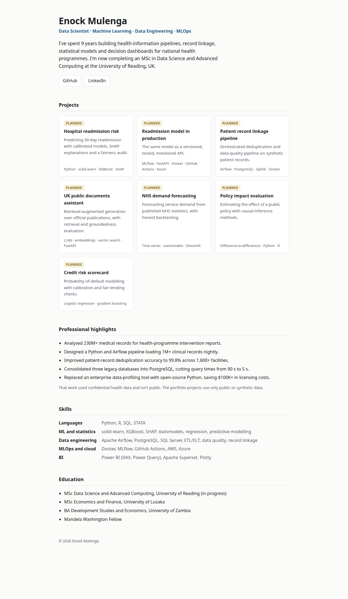

# mulengasnr.github.io

Personal portfolio landing page for Enock Mulenga (Data Scientist), served by GitHub Pages at <https://mulengasnr.github.io>.

**Problem:** recruiters need one place to see who I am, what I've built and where the code lives, in under two minutes.



## How it works
A single static `index.html` with inline CSS: no build step, no JavaScript, no tracking. It supports light and dark mode and works at phone width.

## Run locally
```bash
python3 -m http.server 8000   # then open http://localhost:8000
```

## Updating
When a project is published, change its card's status from **Planned** to **Complete** (or **Deployed**, only with a working link) and link the card title to the repo.

## Next steps
- Link each project card to its repository as projects are published
- Add a headline figure per project
- Add a downloadable CV (PDF) once the UK version is finalised
